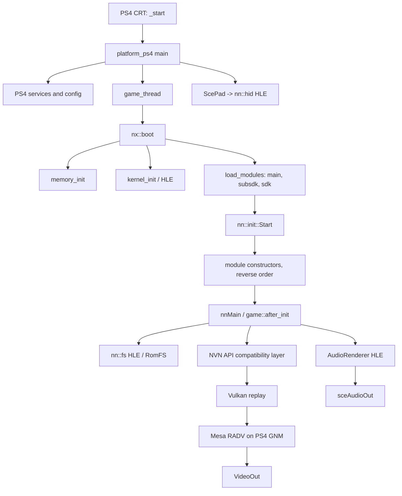
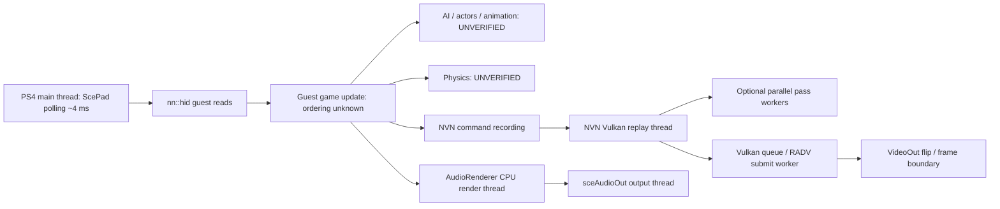

# BOTW runtime architecture audit

## Evidence boundary

This repository is the BOTW PS4 port/toolchain, not a checkout of the generated
game code or the complete recompiler runtime. The shared runtime and its BOTW
changes are represented here by `patches/botw-ps4.patch`; generated `gen/`,
private game dump, and companion `recomp/runtime/src` sources are outside this
repository. Consequently, the bootstrap and platform paths below are
reconstructable from the patch and PS4 logs, but engine classes and most game
subsystem functions cannot be verified from checked-in implementation.

The main evidence is [patches/botw-ps4.patch](../../patches/botw-ps4.patch),
[logs/v00.04/nx.log](../../logs/v00.04/nx.log),
[logs/v00.04/boot-trace.log](../../logs/v00.04/boot-trace.log), and
[docs/GAPS.md](../GAPS.md). Patch line references identify added/changed
runtime code; the patch is not a substitute for the omitted full source.

## Runtime overview

The project recompiles Switch ARM64 modules to host C++ and runs them against
an HLE Nintendo API/runtime. BOTW draws through NVN; the host implementation
records/replays NVN work as Vulkan, with Mesa RADV adapted to PS4 GNM and
VideoOut. The game itself is not a conventional source-built engine in this
checkout: the generated executable and symbols are created from a user-owned
dump by [scripts/prepare-game.sh](../../scripts/prepare-game.sh).

| Finding | File / class | Function or symbol | Purpose | Dependencies | Porting impact |
|---|---|---|---|---|---|
| PS4 process entry | `port/ps4_crt1.S`; no class | `_start`, `_start_ps4_c` | Redirect CRT startup to `__libc_start_main(main, ...)`; install malloc replacement table | OpenOrbis CRT, PS4 libc | Replace CRT/process entry and allocator binding on desktop |
| Platform startup | `patches/botw-ps4.patch:11507` (`runtime/src/platform_ps4.cpp`); `nx::plat` | `main`, `game_thread` | Load PS4 services/config, start platform support and game thread; poll input | `sceUserService`, `scePad`, pthreads, runtime `nx::boot` | Replace PS4 main/platform hooks with a desktop host layer |
| Runtime bootstrap | `patches/botw-ps4.patch:1980` (`runtime/src/main.cpp`); `nx` | `boot`, `nn_main` | Initialize memory/kernel, load modules, run guest `nn::init::Start`, initialize module constructors, call `game::after_init`, dispatch guest `nnMain` | `plat`, HLE kernel/services, module loader | Preserve guest ABI and module ordering; replace platform service implementations |
| BOTW configuration | `patches/botw-ps4.patch:204` (`games/botw/game.cpp`); `nx::game` | `game::after_init`, `game::renderer_start`, `game::first_frame` | Set NVN compatibility and graphics defaults; the last two hooks are empty | BOTW main module, NVN HLE, environment settings | Keep game-specific quirks separate from a new host renderer |
| Module load | `logs/v00.04/nx.log:1-6`; loader implementation in patch at `runtime/src/main.cpp` | `load_modules`, `nn::init::Start` | Load main, subsdk0, sdk at guest base addresses; log links and enter SDK startup | Imported ExeFS, module loader, HLE linker | Module layout and relocation semantics are required for any port |
| Game engine | Not present; generated guest `main` is external | Actor/scene/world/resource/event/AI symbols: **UNVERIFIED** | No checked-in implementation or symbol inventory establishes these classes or call paths | User dump, generated C++ | Do not design replacement APIs from guessed engine class names |

`patches/botw-ps4.patch:204-254` records `game::kInfo`, module assumptions,
`NX_NVN_API=53.311`, depth/equality choices, and optional NVN parallel replay.
The checked runtime calls module constructors in reverse module order (sdk
before main) at `patches/botw-ps4.patch:1980-1990`; the PS4 log confirms entry
to `nn::init::Start` and then `nnMain`.

### Dependency graph



Dependencies above are visible in the port patch and logs. Internal BOTW actor,
world, AI, event, animation, physics, and gameplay edges are **UNVERIFIED**.

## Actor system

| Finding | File / class | Function | Purpose | Dependencies | Porting impact |
|---|---|---|---|---|---|
| Actor manager/factory/system | No definition found in this repository or the runtime patch | `Actor`, `ActorMgr`, `ActorSystem`, `ActorFactory`: **UNVERIFIED** | No verified initialization, update, ownership, or destruction path | Generated guest modules and game data | Capture symbols/traces from a legally obtained build before replacing or adapting |
| Actor lifetime | No checked-in source | **UNVERIFIED** | Creation, world ownership, deferred deletion, and resource release cannot be established | Game allocator, resources, physics, events | Preserve guest object layout and lifecycle until traced; do not infer ownership |

`tools/maxwell/containers.py` in the patch says most other packed BOTW resources
are models, actors, and map data (`patches/botw-ps4.patch:13431-13440`), but
that is an asset-container observation, not an actor-system call path.

## Scene and world systems

| Finding | File / class | Function | Purpose | Dependencies | Porting impact |
|---|---|---|---|---|---|
| Scene manager/scene | No definition found | `SceneMgr`, `GameScene`: **UNVERIFIED** | Scene creation, transition, teardown, and loading ownership are not visible | Guest game code, event flow, resources | Instrument transitions before changing scheduling or lifetime |
| World manager/world | No definition found | `WorldMgr`: **UNVERIFIED** | World streaming, cell/region lifetime, and update path are not visible | RomFS assets, resource loader, physics, actors | The open-world streaming/memory budget is a critical port risk |
| Runtime content root | `patches/botw-ps4.patch:803-890` (`runtime/src/hle_fs.cpp`); `nx::fs` | `load_pack`, `read_game_file`, filesystem HLE entry points | Map `rom:` to extracted RomFS or `romfs.pak`/`romfs.idx`; map `save:` and `cache:` to host-side user directories | `plat::content_root`, host files, pack index | Implement equivalent content and user-data mounts on the target OS |

## AI, events, and resources

| Finding | File / class | Function or symbol | Purpose | Dependencies | Porting impact |
|---|---|---|---|---|---|
| AI/behavior | No definition found | `AIDefinition`, `BehaviorTree`: **UNVERIFIED** | No checked-in type, scheduler, update path, or dependencies | Generated game code | Need game symbols/traces; avoid claiming an AI runtime design |
| Events | No definition found | `EventFlow`, `EventMgr`: **UNVERIFIED** | Event graph execution and event-to-actor dispatch are not visible | Generated game code, assets | Event timing/ownership may constrain save and scene transitions |
| Resource manager | No definition found | `ResourceMgr`: **UNVERIFIED** | No general engine resource cache/owner/lifetime implementation is included | `rom:` I/O, game resource classes | Rebuild resource lifetime and async policy from runtime traces and data |
| Shader assets | `scripts/prepare-game.sh:117-141`; parser changes at `patches/botw-ps4.patch:13416-13502` | `containers.py` functions `open_blob`, `parse_bnsh`, `parse_vfxb` | Offline shader archive extraction and translation inputs | RomFS, Yaz0, SARC, Maxwell shader blocks, Ryujinx translator | Preserve asset discovery and shader identity/cache mapping |

### AI scheduling

The repository proves guest threading and NVN replay workers, not BOTW AI
scheduling. There is no verified `BehaviorTree` scheduler or actor-update
ordering to map onto a desktop job system. This is **UNVERIFIED**.

## Physics

| Finding | File / class | Function or symbol | Purpose | Dependencies | Porting impact |
|---|---|---|---|---|---|
| Havok runtime integration | No Havok headers or source found; no `hkReferencedObject`, `hkpWorld`, `hkpRigidBody`, `hknp`, or `PhysicsMgr` implementation | **UNVERIFIED** | Physics initialization, collision world, simulation step, and shutdown are absent | Compiled game/SDK modules | Identify runtime binary imports and guest callbacks before substituting a physics engine |
| Simulation loop | No checked-in game loop | **UNVERIFIED** | No evidence whether simulation advances in `nnMain`, a guest worker, or fixed ticks | Guest OS/kernel HLE | Avoid moving physics to the host frame loop without timing evidence |

## Startup and shutdown

### Verified startup chain

```mermaid
sequenceDiagram
  participant CRT as PS4 CRT
  participant P as platform_ps4::main
  participant T as game_thread
  participant R as nx::boot/runtime
  participant G as guest SDK/game
  participant V as NVN/Vulkan/RADV
  CRT->>P: _start -> __libc_start_main(main)
  P->>P: load_system_modules; load_config; user/pad init
  P->>T: start_thread(game_thread, 64 MiB stack)
  T->>R: nx::boot()
  R->>R: memory_init(); kernel_init(); load_modules()
  R->>G: nn::init::Start
  G->>G: module constructors (sdk first, main last)
  G->>G: game::after_init(); nnMain
  G->>V: nvnDeviceInitialize and NVN commands
  V->>V: Vulkan device/queue, replay, present
```

Evidence: `_start`/CRT is [port/ps4_crt1.S](../../port/ps4_crt1.S);
`main` and `game_thread` are in the patch at `11507-11544`; `nx::boot` and
`nn_main` at `1980-2005`; boot order is logged at
[logs/v00.04/nx.log](../../logs/v00.04/nx.log). The trace shows SDK module
loading, services including `sm`, `appletOE`, `aoc:u`, and account-user service
`acc:u0`, then the RomFS mount, `vi` native window, NVN device initialization,
and audio-renderer setup. The log does not expose a distinct BOTW actor/world
initialization function.

### Frame and update loop



The input poller and game thread are separate in `runtime/src/platform_ps4.cpp`
as carried in `patches/botw-ps4.patch:10416-11544`. Input reads enter the
guest via `nn::hid` (`patches/botw-ps4.patch:1182` and following); the HLE
maps player input to the platform. Audio has its own render and output threads.
`NX_PIPELINED=1` allows submits to overlap CPU work, and the NVN replay queues
commands in order; GPU fences and present waits provide synchronization
(`patches/botw-ps4.patch:12614-12620`, `9239-9300`, and `13168-13230`).
Large eligible passes can be recorded by up to three worker threads
(`patches/botw-ps4.patch:9239-9350`; the BOTW `NX_PARALLEL` default is at
`204-254`).

No evidence establishes the order of game input processing, AI, physics,
animation, or actor updates within the guest frame. These remain **UNVERIFIED**.

### Shutdown

The `game_thread` calls `nx::plat::exit_process(0)` if `nx::boot` returns
(`patches/botw-ps4.patch:11458-11505`). The checked-in port does not document a
normal game shutdown sequence, destruction order, or orderly stop/join for
audio, graphics, worlds, or actors. **UNVERIFIED:** gameplay shutdown → world
destruction → actor cleanup → physics/audio/graphics shutdown → Nintendo/PS4
service shutdown. A desktop port must not rely on a guessed reverse-startup
order; first establish whether the guest normally exits or is process-terminated.

## Porting risks

| Rank | Risk | Evidence / dependency | Porting impact |
|---|---|---|---|
| Critical | Guest engine architecture is not source-visible | No actor, scene, world, AI, event, physics, or resource-manager implementation in this checkout | Keep guest code intact initially; build instrumentation and derive ownership/update contracts before replacing systems |
| Critical | Guest memory/module ABI | `runtime/src/platform_ps4.cpp` and `runtime/src/main.cpp` changes in patch; `logs/v00.04/nx.log:1-6` | Desktop allocator, virtual memory, exception/fault handling, relocations, guest threading and address layout must preserve runtime assumptions |
| High | World streaming and memory pressure | `docs/GAPS.md` “Memory”; `runtime/src/hle_fs.cpp` patch includes concurrent `.bwav` and RomFS reads | Measure large open-world loads; define bounded async I/O and memory budgets |
| High | Shutdown/update ordering unknown | No normal teardown trace | Avoid lifecycle changes until guest thread and service termination behavior are captured |
| Medium | Version/SDK-sensitive guest functions | `docs/GAPS.md`; 1.5.0 symbols versus 1.6.0 module differences | Support SDK/version discovery rather than hard-coded offsets |
