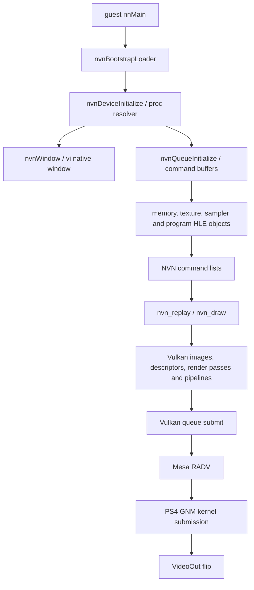

# BOTW graphics and shader audit

## Evidence boundary and rendering overview

The game-facing API is NVN, not Vulkan. The runtime compatibility layer translates
NVN calls and command lists into Vulkan; on PS4, Mesa RADV implements Vulkan over
the GNM kernel interface and a custom VideoOut WSI. The full shared runtime source
is absent from this checkout; its port delta is in
[patches/botw-ps4.patch](../../patches/botw-ps4.patch). PS4 evidence includes
[logs/v00.04/nvn_trace.txt](../../logs/v00.04/nvn_trace.txt) and
[logs/v00.04/nx.log](../../logs/v00.04/nx.log).

| Finding | File / class | Function/symbol | Purpose | Dependencies | Porting impact |
|---|---|---|---|---|---|
| BOTW graphics gate | `patches/botw-ps4.patch:204-254`; `nx::game` | `game::after_init` | Supplies NVN API version 53.311 and BOTW render defaults; comment records that game `nnMain` skips graphics setup below this version | SDK 7.x behavior, NVN HLE | Keep reported API behavior compatible or replace the game-side version check |
| NVN startup evidence | `logs/v00.04/nx.log:39-46` | `nvnDeviceInitialize`, `nvnDeviceGetProcAddress`, `nvnDeviceSetWindowOriginMode`, `nvnQueueAcquireTexture` | Confirms NVN bootstrap calls from game `nnMain` | NVN entrypoint resolver, guest modules | Trace all proc names/versions for the old BOTW SDK |
| Vulkan backend | Patch additions to `runtime/src/nvn/nvn_vk.cpp` and `runtime/src/nvn/nvn_device.cpp` | `init`, `gpu_submit`, `gpu_present`, NVN HLE functions | Vulkan command replay, allocation, pipeline and image handling | Vulkan implementation, shader SPIR-V, RADV or desktop driver | A Vulkan backend is the existing compatibility target; replacing NVN with native engine rendering is a separate, much larger task |
| PS4 WSI | `patches/botw-ps4.patch:12598-13296`; `nx::plat::ps4` | `CreateInstance`, `CreateDevice`, `CreateSwapchainKHR`, `AcquireNextImageKHR`, `QueuePresentKHR` | Exposes headless Vulkan surface/swapchain backed by linear VideoOut buffers | RADV ICD proc address functions, PS4 VideoOut, GNM submit/flip | Replace WSI, memory alignment and presentation synchronization on desktop |

## NVN API inventory and startup

The NVN trace lists function names and driver addresses for the API observed
from the game and SDK. It is not a complete static call graph: API callers are
present for observed calls, but not every call is printed. The full guest
implementation has no C++ class boundary at the call site; the receiving HLE
functions are in the omitted runtime sources named in the patch.

| File | Class | Function/symbol | Purpose | Callers/evidence | Dependencies | Porting impact |
|---|---|---|---|---|---|---|
| `logs/v00.04/nx.log:39-45` | none (guest C API) | `nvnBootstrapLoader`, `nvnDeviceInitialize`, `nvnDeviceGetProcAddress`, `nvnDeviceSetWindowOriginMode` | Bootstrap and initialize game graphics device | `nnMain` caller is logged as `main+e552c0`, `main+e55510` | BOTW NVN 53 API compatibility | Resolve every requested function name with version-specific signatures |
| `logs/v00.04/nvn_trace.txt:1-15` | NVN device/queue builders | `nvnDeviceBuilderSetDefaults`, `nvnDeviceBuilderSetFlags`, `nvnQueueBuilderSetDevice`, `nvnQueueBuilderSetDefaults`, `nvnQueueBuilderSetFlags`, `nvnQueueBuilderSetCommandMemorySize`, `nvnQueueBuilderSetComputeMemorySize`, `nvnQueueBuilderSetControlMemorySize`, `nvnQueueBuilderGetQueueMemorySize` | Configure device and queue storage | SDK functions logged as `sdk+...`; concrete guest call for `nvnDeviceInitialize` at trace line 213 | Guest SDK 7.3.2 and NVN HLE | Queue memory model and ABI differ from desktop Vulkan; preserve NVN semantics at HLE boundary |
| `logs/v00.04/nx.log:45-46` | NVN window/queue | `nvnQueueAcquireTexture`; window has two active textures and present interval 1 | Acquire render target from game window | `main+1259770`; window object logged at line 45 | `nn::vi` native window and NVN HLE | Map acquired textures to desktop swapchain images |
| `logs/v00.04/nx.log:46-49` | command buffer | `nvnCommandBufferSetMemoryCallback`, `nvnCommandBufferSetMemoryCallbackData`, `nvnCommandBufferSetShaderScratchMemory` | Configure command memory and shader scratch | callbacks from `nnMain` and game code | NVN queue/command buffer lifecycle | Implement callback lifetime, guest-memory visibility, and scratch allocations |
| `logs/v00.04/nx.log:49-51` | device/texture/sampler | `nvnDeviceRegisterFastClearColor`, `nvnTextureCompare`, `nvnSamplerCompare` | Register fast clear and compare guest texture/sampler descriptors | Call sites include `main+151b548`, `main+1289bb4`, `main+12814b0` | descriptor layouts and format translation | Descriptor snapshots and object copies are correctness-sensitive |
| `logs/v00.04/nvn_trace.txt:1-442` | memory/texture/sampler/command objects | `nvnMemoryPool*`, `nvnTexturePool*`, `nvnSamplerPool*`, `nvnProgram*`, `nvnShader*`, `nvnCommandBuffer*`, queue/window functions | Observed NVN entrypoint and driver map | Trace comments label resolved SDK driver addresses; API invocations include caller LR | SDK-specific proc map | Regenerate/verify symbol/proc inventory against BOTW’s older SDK |
| `patches/botw-ps4.patch:3515-3650`, `5607-6164`, `6711-7098` | `nx::nvn` (runtime patch; no guest class) | device, memory pool, texture, window, sampler initialization HLE | Provide guest-visible object state and descriptor handling | Registered through NVN HLE names | Guest object layouts, Vulkan images and pools | Several object layouts differ between SDK generations; avoid hard-coded SDK 16 offsets |
| `patches/botw-ps4.patch:6711-6820`, `6820-6927`, `9239-9302` | NVN queue/replay | `gpu_submit`, `gpu_present`, `present_headless` (runtime patch) | Replay submits, frame timing, surface presentation | invoked by queued guest NVN command lists | Vulkan queue, fences, swapchain | Preserve queue ordering, barriers, timing and in-flight resource lifetime |

The log directly verifies device setup and queue-acquired textures. MemoryPool
and TexturePool call families appear in the NVN trace and patch registration
table; **UNVERIFIED** here are a complete per-entrypoint caller graph and
whether every proc in the trace is reached by normal gameplay.

### NVN-to-host call graph

Exact NVN internal function fan-out and all render-pass/pipeline creation call
sites are **UNVERIFIED** without the full runtime checkout. The named patch
files and observed logs support the API boundary and backend layering.

## Vulkan backend

**Classification: port/compatibility backend for NVN, not the game’s primary API.**
The BOTW engine enters NVN; Vulkan is used by the recompiler runtime to replay
NVN work. It is neither evidence of a native Vulkan BOTW renderer nor an
independent Vulkan renderer path.

| Vulkan stage | File / class | Function/symbol | Purpose | Dependencies | Porting impact |
|---|---|---|---|---|---|
| Entry/proc dispatch | `patches/botw-ps4.patch:12641-12680` | `vk_icdGetInstanceProcAddr`, `vk_common_GetDeviceProcAddr`, `instance_fn`, `device_fn` | Access linked RADV Vulkan implementation | Mesa dispatch functions | Desktop can use the platform Vulkan loader/driver, subject to runtime’s proc-dispatch assumptions |
| Instance creation | `patches/botw-ps4.patch:12738-12760` | `CreateInstance` | Remove headless/surface extensions from forwarded RADV request and publish WSI extensions | RADV ICD | Do not carry PS4-only WSI extension filtering blindly |
| Physical-device and queue selection | Base runtime `runtime/src/nvn/nvn_vk.cpp` is not present; its BOTW delta starts at patch line 9239 | **UNVERIFIED exact function names and selection policy** | Runtime initialization must select a Vulkan device/graphics queue | Vulkan enumeration and queue-family APIs | Verify physical-device preference, queue family, extensions and feature requirements from full source |
| Logical device | `patches/botw-ps4.patch:12762-12776` | `CreateDevice` | Track selected physical device and strip swapchain extension before creating the underlying RADV device | `vkCreateDevice` | Desktop WSI extension must be enabled natively; remove the compatibility shim where possible |
| Surface/swapchain | `patches/botw-ps4.patch:12776-12950` | `CreateHeadlessSurfaceEXT`, `CreateSwapchainKHR`, `GetSwapchainImagesKHR` | Represent a headless surface; allocate linear RGBA images, map memory and register VideoOut buffers | Host-visible Vulkan memory, PS4 2 MiB VideoOut alignment, VideoOut API | Replace PS4 image format, presentation, alignment, buffer registration, and resize handling |
| Acquire/present | `patches/botw-ps4.patch:13145-13252` | `AcquireNextImageKHR`, `QueuePresentKHR`, `QueueSubmit` | Rotate images, wait until a buffer is off-screen, submit through GNM/VideoOut | One in-order queue, flip events, custom semaphore handling | Desktop should use native swapchain acquire/present and ordinary Vulkan semaphores/fences |
| Render pass/pipeline | `patches/botw-ps4.patch:3561-4458` (`runtime/src/nvn/nvn_draw.cpp`), `6382-6710` (`nvn_pipeline.cpp`), and `9239-9302` (`nvn_vk.cpp`) | `draw_command`, `gpu_submit`, pipeline/render-pass builders | Recreate NVN render state and issue Vulkan draws | shader reflection, descriptors, formats, depth/blend state | Preserve NVN dynamic state, pass boundaries, aliases, tiling and exact depth behavior |

The patch and Windows debug notes document frame replay, pipeline caches,
descriptor sets and the PS4 presentation path; they do not prove a distinct
`vkCreateRenderPass` or `vkCreateGraphicsPipelines` call sequence in the patch
alone. Those exact Vulkan entrypoints and startup ordering remain **UNVERIFIED**
until the complete `runtime/src/nvn` sources are available.

## Shader pipeline

| Finding | File / class | Function/symbol | Purpose | Dependencies | Porting impact |
|---|---|---|---|---|---|
| Source containers | `patches/botw-ps4.patch:13416-13502`; `tools/maxwell/containers.py` in the patch | `open_blob`, `parse_fsha`, `parse_vfxb`, `parse_bnsh` | Recognize SARC, Yaz0, FSHA/BFSHA-like archives, BAHS, VFXB/BNSH shader blocks | RomFS, SARC/Yaz0 readers | Preserve archive versions and per-member decompression |
| Offline extraction | `scripts/prepare-game.sh:117-141` | shader extraction loop and `exefs_shaders.py` | Find shader containers in RomFS and ExeFS | Python venv, Capstone, .NET SDK, Ryujinx translator | Desktop runtime has no source shader compiler requirement if SPIR-V assets are complete |
| Translation | `scripts/prepare-game.sh:110-141`; `docs/GAPS.md` shader section | `SpirvHarness` batch invocation | Maxwell guest programs → SPIR-V `.spv`; validation via `spirv-val` when installed | Ryujinx shader translator, .NET 10, SPIR-V tools | Keep translation reproducible and validate target Vulkan capabilities |
| Runtime loading | `scripts/prepare-game.sh:129-141`; `logs/v00.04/nx.log:63` | hash lookup under `/data/BOTW/spirv`; 7,878 shader records | Load pretranslated SPIR-V; log missing shaders | runtime NVN shader HLE, shader hash manifest | Ship complete shader cache or add a deliberate runtime translation/cache design |
| Program/material binding | Full `runtime/src/nvn/nvn_shaders.cpp` and material loader absent | **UNVERIFIED** | No proven BOTW material-to-program runtime mapping in this checkout | BFRES/BFSHA-derived material data, generated guest code | Trace material/program binding before replacing pipeline layout or cache key |

### Formats found

| Format | Source form / intermediate | Compiler or parser | Cache/runtime loader | Evidence and limitations |
|---|---|---|---|---|
| Maxwell guest shaders | NVN code blocks; BNSH 2.1.x can start at offset 0 without the NVN header | `containers.py` parsing and Ryujinx translator, offline | SPIR-V per content hash, loaded by runtime from `spirv/` | `scripts/prepare-game.sh:120-141`; `patches/botw-ps4.patch:13416-13502` |
| FSHA / `.sbfsha` | FSHA 3.0.1 archive containing Yaz0-compressed SARC members and BNSH 2.1.2 programs | `parse_fsha`, fallback by BNSH magic | Extracted to SPIR-V ahead of launch | `docs/GAPS.md` and `prepare-game.sh` comments; version-specific archive support |
| VFXB / `.sesetlist` | Effect sections GRSN/GRSR and GRSC containing BNSH | `parse_vfxb`; `.sesetlist` may be nested in event packs | Offline shader extraction; runtime asks for corresponding SPIR-V | `patches/botw-ps4.patch:13416-13502`; effects in `Effect` and `Event` |
| BAHS / `.ssarc` | AGL/GSYS/KSys archive structures | Shader-container parser | Extracted SPIR-V; runtime pipeline creation | BOTW archive class is recorded in `docs/GAPS.md`; full material loader absent |
| BNTX | Tiled texture asset data | No independent BNTX parser/loader in this repository | Runtime NVN texture HLE uses guest texture metadata and memory; exact asset-to-image path is unavailable | BNTX is named in patch comments around texture formats; loader is **UNVERIFIED** |
| BFRES | Model/resource container | No verified BFRES parser or runtime loader found | **UNVERIFIED** | Do not assume BFRES is consumed by a host resource manager; it is likely handled by guest code, but this is not established here |

Runtime compilation and on-device shader-cache generation are not established
as BOTW shader paths. The documented PS4 workflow pretranslates to SPIR-V;
missing entries are logged (`docs/GAPS.md`, shader/runtime miss handling in
`scripts/prepare-game.sh:129-141`). The complete pipeline-cache persistence
implementation is outside the present source tree.

## Graphics porting risks

| Rank | Risk | Evidence | Porting impact |
|---|---|---|---|
| Critical | NVN 53 / SDK 7 ABI and object layouts | `logs/v00.04/nx.log:39-46`; `docs/GAPS.md` older-SDK warnings; NVN object HLE delta in patch | Validate proc names, descriptors, texture/sampler sizes, and command ABI against target game version |
| Critical | NVN semantic translation and frame-order correctness | `docs/GAPS.md` black-screen/texture-holder incidents; runtime patch `nvn_draw.cpp` | Keep record-time texture identity, clear/copy ordering, barriers and alias tracking correct |
| High | Shader completeness and format compatibility | `docs/GAPS.md` reports 7,870/7,878 translated; 8 vertex shader failures | Build shader coverage checks and target-device SPIR-V validation |
| High | PS4-only WSI and synchronization | `patches/botw-ps4.patch:12598-13296` | Replace VideoOut buffer rotation/GNM flip and remove semaphore workarounds for desktop |
| High | Shader translation and pipeline performance | `docs/GAPS.md` reports replay CPU-bound around 3,000 draws/frame; replay worker changes untested on console | Profile desktop GPU and CPU separately; do not assume Vulkan GPU load is the bottleneck |
| Medium | Tiling, ASTC and texture alias semantics | `patches/botw-ps4.patch:9239-10415`; texture layout/writeback diagnostics in `docs/GAPS.md` | Compare guest memory layout/swizzles with host Vulkan image layout and format feature support |
| Medium | Render resolution, depth and PS4 defaults | `game::after_init` patch lines 204-254; Windows debugging notes | Make scaling, depth clamp/equality and present behavior target-specific |
| Low | Trace and log paths hard-coded to PS4 data root | `scripts/prepare-game.sh`, `scripts/stage-data.sh`, platform patch | Move paths to a portable user-data/config directory |
