# BOTW runtime compatibility knowledge graph

## Scope and evidence legend

This graph consolidates the checked-in porting audits. It describes the
recompiler/runtime, guest-facing compatibility layer, PS4 platform
implementation, tooling, and rendering path—not proprietary BOTW gameplay
internals. The complete generated game and matching shared runtime sources are
not present; the runtime changes are represented by
[patches/botw-ps4.patch](../../patches/botw-ps4.patch).

- **Verified** — documented by implementation deltas, runtime logs, or
  checked-in tooling.
- **Partial** — a specific HLE/platform path exists, but does not establish
  full Nintendo service compatibility.
- **Proposed** — a target-port recommendation, not an implemented backend.
- **UNVERIFIED** — missing evidence; do not infer guest/game behavior.
- Solid graph edges indicate an evidenced dependency. Dotted edges are
  explicitly unknown or not proven as a runtime dependency.

The graph reuses the established evidence in
[architecture.md](./architecture.md), [graphics.md](./graphics.md),
[services.md](./services.md), and the focused
[service matrix](./service_matrix.md), [runtime/thread graph](./runtime_dependency_graph.md),
[memory model](./memory_model.md), [NVN lifecycle](./nvn_lifecycle.md),
[platform replacement plan](./platform_replacement_plan.md), and
[unverified register](./unverified_findings.md).

## Consolidated dependency graph

```mermaid
flowchart LR
  subgraph BUILD["Import and preparation (host tooling)"]
    DUMP["User-owned game dump"] --> PREP["prepare-game.sh / importer"]
    PREP --> MODULES["ExeFS guest modules"]
    PREP --> ROMFS["Extracted RomFS"]
    ROMFS --> PACK["Optional romfs.pak + romfs.idx"]
    ROMFS --> SCAN["Offline shader-container scan"]
    SCAN --> TRANSLATE["Maxwell → SPIR-V translation"]
    TRANSLATE --> SPIRV["spirv/<hash>.spv"]
  end

  subgraph BOOT["Runtime bootstrap"]
    CRT["PS4 CRT _start"] --> PLATFORM["platform_ps4::main"]
    PLATFORM --> SYSTEM["PS4 modules / user and pad setup"]
    PLATFORM --> INPUT["Input polling (~4 ms)"]
    PLATFORM --> GTHREAD["game_thread"]
    GTHREAD --> BOOTFN["nx::boot"]
    BOOTFN --> INIT["memory_init → kernel_init"]
    INIT --> LOAD["load_modules"]
    MODULES --> LOAD
    LOAD --> SDK["nn::init::Start"]
    SDK --> CTORS["Module constructors"]
    CTORS --> ENTRY["Guest nnMain"]
  end

  subgraph SERVICES["Guest API compatibility and host services"]
    ENTRY --> FS["nn::fs HLE"]
    FS --> VFS["rom: / save: / cache:"]
    VFS --> CONTENT["Folder RomFS or indexed pack"]
    CONTENT -. "game archive-to-object path unknown" .-> ASSETS["Guest resources / actors / materials"]

    INPUT --> PAD["PadState snapshot"]
    PAD --> HID["nn::hid HLE"]
    HID --> ENTRY

    ENTRY --> AUDIO["nn::audio / AudioRenderer HLE"]
    AUDIO --> DSP["Guest SDK DSP on CPU (~5 ms)"]
    CONTENT -. ".bwav file reads; ownership unknown" .-> DSP
    DSP --> PCM["Host PCM queue"]
    PCM --> AUDIOOUT["PS4 sceAudioOut thread"]
    AUDIOOUT --> SPEAKER["sceAudioOut"]

    ENTRY --> VI["nn::vi layer/window HLE"]
    VI --> SURFACE["PS4 headless Vulkan surface"]
    ENTRY --> OS["nn::os guest synchronization HLE"]
    OS --> KERNEL["Runtime kernel objects / host pthreads"]

    ENTRY -. "acc:u0 request; no full account HLE proven" .-> ACCOUNT["Account service request"]
    SYSTEM -. "PS4 users map to controller players only" .-> ACCOUNT
    FS -. "account-to-save relation unknown" .-> SAVE["Host save/cache directories"]
    ENTRY -. "no guest socket path established" .-> SOCKET["nn::socket: UNVERIFIED"]
    ENTRY --> OE["Narrow nn::oe HLE"]
    OE --> OE_FALSE["Launch/notification pop returns false"]
  end

  subgraph GRAPHICS["NVN to platform presentation"]
    ENTRY --> NVN["Guest NVN API (observed v53.311)"]
    SPIRV --> SHADER["NVN shader/program HLE"]
    NVN --> OBJECTS["NVN pools, textures, descriptors, command lists"]
    SHADER --> OBJECTS
    OBJECTS --> SUBMIT["Ordered submit/replay worker"]
    SUBMIT --> VK["Vulkan command buffers, pipelines, fences"]
    VK --> RADV["PS4 Mesa RADV / GNM winsys"]
    RADV --> WSI["Custom PS4 Vulkan WSI"]
    SURFACE --> WSI
    WSI --> VIDEO["VideoOut buffer registration / flip"]
    VIDEO --> DISPLAY["PS4 display"]
  end

  subgraph MEMORY["Memory and resource lifetime"]
    GUESTVA["Guest VA reservation / commit"]
    DIRECT["PS4 direct-memory backing"]
    HOSTHEAP["Flexible-memory-first host heap"]
    POOLS["NVN guest memory pools / GPU address map"]
    RING["64 MiB PS4 upload ring + spill buffers"]
    GPUOBJ["Vulkan images / descriptors / submit slots"]
    SWAP["Linear host-visible WSI images"]
    GUESTVA --> DIRECT
    DIRECT --> POOLS
    POOLS --> GPUOBJ
    RING --> GPUOBJ
    GPUOBJ --> SWAP
    SUBMIT --> RETIRE["Fence/serial-based retirement"]
    RETIRE --> POOLS
    RETIRE --> RING
    RETIRE --> GPUOBJ
  end

  subgraph THREADS["Runtime workers and synchronization"]
    INPUT
    GAMEWORK["Guest game thread"]
    REPLAYWORK["NVN ordered replay"]
    PASSWORK["Optional pass-recording workers"]
    RADVWORK["RADV/GNM submit worker"]
    DSPWORK["Audio render worker"]
    OUTWORK["Audio output worker"]
    VSYNC["VI vsync event thread"]
    FILEIO["Synchronous file reads + bounded read-ahead"]
    KERNEL --> GAMEWORK
    KERNEL --> REPLAYWORK
    REPLAYWORK -. "eligible submits" .-> PASSWORK
    KERNEL --> RADVWORK
    KERNEL --> DSPWORK
    DSPWORK --> OUTWORK
    KERNEL --> VSYNC
    FS --> FILEIO
  end

  subgraph TARGET["Desktop target (proposed, not implemented here)"]
    SDL["SDL3: window / input / audio"]
    VULKAN["Vulkan 1.3 native WSI"]
    STDFS["std::filesystem + standard file I/O"]
    WINDOWS["Windows"]
    LINUX["Linux"]
    DECK["Steam Deck / SteamOS"]
    WINDOWS --> SDL
    LINUX --> SDL
    DECK --> SDL
    SDL --> VULKAN
    WINDOWS --> STDFS
    LINUX --> STDFS
    DECK --> STDFS
    SDL -. "proposed platform replacement" .-> PLATFORM
    VULKAN -. "proposed WSI replacement" .-> WSI
    STDFS -. "proposed host VFS implementation" .-> VFS
  end
```

The `TARGET` subgraph is a replacement direction, not a dependency of the
current PS4 runtime. SDL3 is the requested target abstraction; the earlier
[services audit](./services.md) mentions SDL2 in historical porting
recommendations. The more specific [replacement plan](./platform_replacement_plan.md)
sets SDL3, Vulkan 1.3, and standard filesystem APIs as the proposed target.

## Verified chains and ownership boundaries

| Chain | Consolidated path | Boundary / qualification |
|---|---|---|
| Startup | `_start` → `platform_ps4::main` → `game_thread` → `nx::boot` → guest module load → `nn::init::Start` → constructors → `nnMain` | Guest modules are generated from the user-owned dump. The internal game initialization beyond observed entry calls is not reconstructed. |
| Content | `prepare-game.sh` → ExeFS/RomFS staging → optional `romfs.pak`/index → guest `nn::fs` HLE → host files | Pack/VFS behavior is established; archive-to-general-game-object parsing and ownership are **UNVERIFIED**. |
| Shader | RomFS/ExeFS containers → offline Maxwell extraction/translation → hash-named SPIR-V → NVN program/shader HLE → Vulkan pipeline work | Offline shader tooling is distinct from a general BFRES/BNTX/resource loader. Coverage and material binding retain the limitations in [graphics.md](./graphics.md). |
| Input | PS4 `ScePad` polling → `PadState` snapshot → `nn::hid` HLE → guest input reads | Partial: four-player state is adapted; sensor data and vibration are reduced or absent. |
| Audio | Guest `nn::audio` → CPU execution of SDK AudioRenderer/DSP → PCM queue → `sceAudioOut` | Guest DSP and platform output are separate. Guest source buffers remain live until output completion. Game-level BGM/SE/voice ownership is **UNVERIFIED**. |
| Rendering | Guest NVN objects/commands → ordered replay → Vulkan commands/fences → RADV/GNM → PS4 WSI → VideoOut flip | NVN, not native game Vulkan, is the guest API. PS4 semaphore stripping and flip synchronization are WSI-specific and must not be copied to desktop. |
| Synchronization | Guest `nn::os` HLE → runtime locks/condition variables and host threads; NVN uses serials/fences; WSI uses flip events | Preserve guest timeout/wake semantics, GPU-visible writebacks, in-flight object lifetime, and image reuse ordering. |
| Saves | Guest `save:`/`cache:` → host user directories; `CommitSaveData` → host `Commit` | User-service initialization is evidenced, but account-to-save binding, save slots/schema, and atomicity are **UNVERIFIED**. |

### Memory and lifetime join

- Guest virtual addresses, PS4 direct-memory backing, and the host allocator
  are separate domains. The lazy guest allocator maps committed 64 KiB chunks
  backed by direct memory; the PS4 host heap uses flexible-memory-first
  `dlmalloc` mspaces with fallback pools.
- NVN memory pools map guest-visible GPU ranges. Submit slots own upload-ring
  intervals, descriptor/command-pool state, and temporary resources until
  fences and serials permit retirement.
- Texture structs, texture-pool snapshots, Vulkan images, and guest backing
  are distinct objects. Aliases, copied texture structs, and deferred
  destruction require stable identities and completion-aware lifetime.
- The PS4 WSI owns linear host-visible images registered to VideoOut; swapchain
  destruction waits for device idle and unregisters them.
- File handles are bounded views into a shared RomFS pack. `.bwav` read-ahead
  is per-handle (up to 512 KiB) and globally budgeted (16 MiB); no general
  asynchronous I/O worker is established.

## Known gaps and documentation qualifications

| Topic | Consolidated status |
|---|---|
| Guest gameplay architecture | Actors, scenes, world streaming, AI, events, physics, animation, and update ordering are **UNVERIFIED**. No gameplay architecture should be inferred from host worker threads or asset names. |
| Services | `nn::fs`, `nn::hid`, `nn::audio`, and `nn::vi` have partial HLE paths; `nn::oe` has narrow false-return handlers; `nn::account` is observed but no full guest account HLE is established; guest `nn::socket` is not established. Generic unhandled IPC commands returning zero do not count as implemented behavior. |
| I/O/thread topology | Input, game, replay, optional render/pipeline/ASTC, RADV, audio-render, audio-output, and VI workers are documented. Filesystem reads are synchronous in the inspected path; a general I/O scheduler is **UNVERIFIED**. |
| Thread-stack backing | The patch’s memory-guard comment says flexible memory, but the explicit guest `start_thread()` path uses lazy guest stack slots backed by lazy/direct memory. The no-slot pthread fallback’s physical backing is unspecified. See [U12](./unverified_findings.md). |
| Save/profile lifecycle | Host save/cache paths and a commit-symbol registration exist; account binding, slot schema, commit durability, unmount sequence, and normal teardown remain **UNVERIFIED**. |
| Vulkan selection and runtime | NVN→Vulkan→RADV/VideoOut is established on PS4. Exact Vulkan device/queue selection and some pipeline/cache behavior remain **UNVERIFIED** without the full runtime source. |
| Repository inventory | `filetree.txt` is a point-in-time tree that lists the original three porting audits, not the later audit documents. Use the actual directory contents for the current documentation set; this graph is the consolidated index. |
| Desktop support | Windows, Linux, and Steam Deck SDL3/Vulkan 1.3/standard-filesystem integration is **PROPOSED** only. The existing PS4 implementation does not prove a desktop build. |

## Source investigation boundary

This consolidation makes no new repository-wide source scan. Existing source
investigation is reused from the audits. The only implementation conflict
called out here is the already-recorded thread-stack comment discrepancy; the
implementation-path finding in [memory_model.md](./memory_model.md) and
[unverified_findings.md](./unverified_findings.md) takes precedence over the
broad comment. Other open questions are intentionally left **UNVERIFIED**
rather than resolved by assumptions.

## Evidence map

- [architecture.md](./architecture.md) — source boundary, bootstrap, guest
  boundary, module order, and gameplay areas not present.
- [services.md](./services.md) — filesystem, audio, threading, platform
  dependencies, save/account, and Nintendo-service inventory.
- [graphics.md](./graphics.md) — NVN API and shader evidence, Vulkan replay,
  PS4 WSI, and graphics risks.
- [filetree.txt](./filetree.txt) — repository inventory snapshot; not a current
  source or documentation index.
- [service_matrix.md](./service_matrix.md) — per-service feature/status matrix.
- [runtime_dependency_graph.md](./runtime_dependency_graph.md) — worker threads
  and synchronization points.
- [memory_model.md](./memory_model.md) — memory domains, stack discrepancy,
  and ownership lifetimes.
- [nvn_lifecycle.md](./nvn_lifecycle.md) — command/resource-to-present lifecycle.
- [platform_replacement_plan.md](./platform_replacement_plan.md) — proposed
  Windows/Linux/Steam Deck adapters.
- [unverified_findings.md](./unverified_findings.md) — unresolved claims and
  evidence needed to close them.
