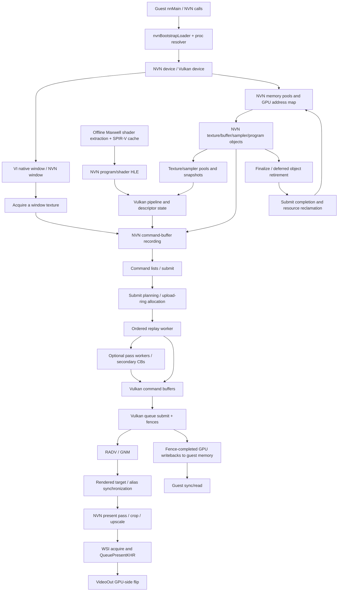

# NVN command and resource lifecycle

## Scope and evidence boundary

BOTW calls NVN (the observed API version is 53.311). The host compatibility
path records guest NVN commands, replays them as Vulkan work, and presents via
the platform WSI. The complete `runtime/src/nvn` sources are not checked in;
the checked-in evidence is the PS4 runtime patch, logs, and the graphics audit.
This lifecycle covers that compatibility path, not an independent BOTW Vulkan
renderer.

## Lifecycle graph

## Command and resource lifecycle

| Stage | Caller → callee | Resources created or borrowed | Ownership / completion |
|---|---|---|---|
| 1. API bootstrap | Guest `nnMain` → `nvnBootstrapLoader`, `nvnDeviceInitialize`, `nvnDeviceGetProcAddress` | Guest NVN device/queue/window descriptors; runtime dispatch entries | The observed BOTW trace confirms these calls. The complete old-SDK proc caller graph is not available. |
| 2. Device/window setup | Guest NVN builders → `nx::nvn` HLE and Vulkan backend; guest `nn::vi` setup → platform surface | Vulkan instance/device/queue; VI window handle; swapchain | PS4 platform supplies a headless Vulkan surface; custom WSI owns VideoOut buffers. |
| 3. Pool setup | Guest `nvnMemoryPoolInitialize/Map` → HLE pool map | Guest memory or virtual pool mappings; NVN GPU address range | Pool registration adds GPU-address lookup. Pool finalization waits for replay/worker/GPU references before unregister/destroy. |
| 4. Object setup | Guest `nvnTextureInitialize`, `nvnSamplerInitialize`, buffer/program calls → object HLE | Host object state; texture backing memory; views and descriptors; shader modules | Texture state is keyed by guest struct address. BOTW copies texture structs, so the patch stamps/adopts copied incarnations and snapshots descriptor registrations. |
| 5. Shader availability | Offline `prepare-game.sh` scan → Maxwell translator → `spirv/<hash>.spv`; runtime program/shader HLE consumes SPIR-V | Shader archive bytes, translated SPIR-V, Vulkan shader/pipeline objects | Offline extraction is documented. Runtime material-to-program ownership and all runtime pipeline-cache persistence are not fully evidenced. |
| 6. Command recording | Guest command-buffer calls → HLE command recorders (`nvn_cmd.cpp`, draw/state/copy code) | `CmdList` and command payloads; guest-memory references; recorded texture keys | Command lists are kept stable for a submit, so a concurrently re-recorded guest list does not mutate an in-flight replay’s list. |
| 7. Submit planning | Guest queue submit → `gpu_submit()` | Submit slot, upload-ring ranges, descriptor sets, Vulkan command pools/buffers | PS4 config enables pipelined work. Eligible large no-dispatch submits can use pass-recording workers; profiling/zero-draw modes disable that path. |
| 8. Replay and translation | Replay worker → `replay_list()` / `draw_command()` / copy and clear routines | Vulkan render passes, barriers, descriptors, images, pipelines, upload buffers | A single worker replays submissions in order. Optional secondary command buffers use per-worker slot-owned pools and descriptors. |
| 9. GPU execution | Vulkan queue → RADV → GNM | In-flight Vulkan commands and referenced resources | Fences and submit serials gate slot retirement, writebacks, and image/object reclamation. PS4’s Vulkan/GNM queue assumptions are platform-specific. |
| 10. Guest-memory visibility | Fence completion → deferred writebacks → guest memory | Compute/copy results and invalidated memory-pool ranges | Pipelined compute/copy output is written back only after its fence. Guest sync/wait, `QueueFinish`, pool invalidation, and finalization are ordering points. |
| 11. Present | NVN present → `gpu_present()` → `QueuePresentKHR()` → `ac_ps4_submit_flip()` | Present image, optional FSR/crop pass, WSI image index, VideoOut buffer | WSI waits until a selected image is off-screen; GPU-side flip is ordered behind frame work. Fallback waits for queue idle before CPU-side flip. |
| 12. Finalize and retire | Guest finalize → NVN object/fence/worker helpers → deferred destruction | Pools, textures, snapshots, images, pipelines, upload/staging allocations | Finalization waits for work that may still use the resource. Image/object graves are released only after the completed submit serial advances. Swapchain destruction waits for device idle and unregisters VideoOut buffers. |

### Resource ownership details

- **Guest texture structs are not host Vulkan images.** The HLE tracks NVN
  texture description/backing separately from `GpuImage`. Texture pool
  registrations snapshot views/state; BOTW’s copied temporary texture
  structures require adoption/stable host keys so recorded render targets do
  not resolve to a later incarnation at the same guest address.
- **Guest memory is the authoritative CPU-visible storage.** `MemoryPoolFlush`
  marks cached textures/vertex data dirty; uploads or texel writes update the
  host image and, where required, the guest’s pitch/block-linear memory. Alias
  tracking reconciles different Vulkan images backed by the same guest memory.
- **Command lists and resources have different owners.** The game owns guest
  NVN objects and command handles. The runtime owns HLE objects, snapshots,
  Vulkan objects, submit slots, and deferred destruction. GPU completion
  serials bound the overlap.
- **The upload ring is submit-scoped, not command-list-scoped.** The runtime
  allocates aligned spans, may spill when a busy submit exhausts the ring, and
  retires a span after the associated GPU work is complete.
- **The PS4 swapchain is platform-owned.** WSI-created images are registered
  with VideoOut, rotated and waited off-screen before reuse, and destroyed
  with their VideoOut registration.

## Presentation and synchronization specifics

The PS4 WSI advertises surface/swapchain extensions over linked RADV, creates
linear `R8G8B8A8_UNORM` images in host-visible memory, and registers their
addresses with VideoOut. It supports a fixed 1920×1080 extent. Present uses
`flipArg` and a VideoOut event queue to determine when an image is no longer
on screen.

This WSI deliberately strips binary wait and signal semaphores from every
`vkQueueSubmit`; the patch comments state that such submissions can lose the
PS4 device when no other work is present. `AcquireNextImageKHR` waits for
image reuse and does not signal its semaphore. An optional fence is signaled
by an empty queue submit. `QueuePresentKHR` queues the flip behind GPU work,
falling back to `vkQueueWaitIdle` plus `sceVideoOutSubmitFlip` if the GPU-side
flip fails. This workaround is not suitable for a native desktop WSI.

## Callers, callees, and evidence

| Caller | Callee / path | Evidence |
|---|---|---|
| BOTW `nnMain` | NVN bootstrap and proc resolver | [graphics.md](./graphics.md#nvn-api-inventory-and-startup), `logs/v00.04/nx.log` |
| Guest NVN command-buffer functions | HLE recorders, then `gpu_submit()` and `replay_list()` | [NVN command/pipeline/replay deltas](../../patches/botw-ps4.patch#L2555) |
| `gpu_submit()` | replay worker, frame slot, Vulkan queue | [NVN Vulkan delta](../../patches/botw-ps4.patch#L9239), [worker delta](../../patches/botw-ps4.patch#L9427) |
| `gpu_present()` | WSI `QueuePresentKHR()` → `ac_ps4_submit_flip()` → GNM/VideoOut | [PS4 WSI implementation](../../patches/botw-ps4.patch#L12598) |
| Guest pool/object finalize | submit wait, worker finish, GPU writeback wait, deferred destroy | [NVN object delta](../../patches/botw-ps4.patch#L5537), [frame-retirement delta](../../patches/botw-ps4.patch#L4966) |

## Explicitly unverified

- Complete per-proc BOTW caller graph and all NVN 53 entrypoint semantics.
- Exact Vulkan physical-device/queue selection and all pipeline-creation paths.
- Full runtime shader material/program binding and persistent pipeline-cache
  implementation.
- Any game-level resource/actor ownership beyond guest-visible NVN objects.
- Complete teardown behavior for detached replay/worker threads and platform
  WSI after normal guest exit.

The checked-in [graphics audit](./graphics.md) remains authoritative for shader
coverage and version-specific rendering risks.
