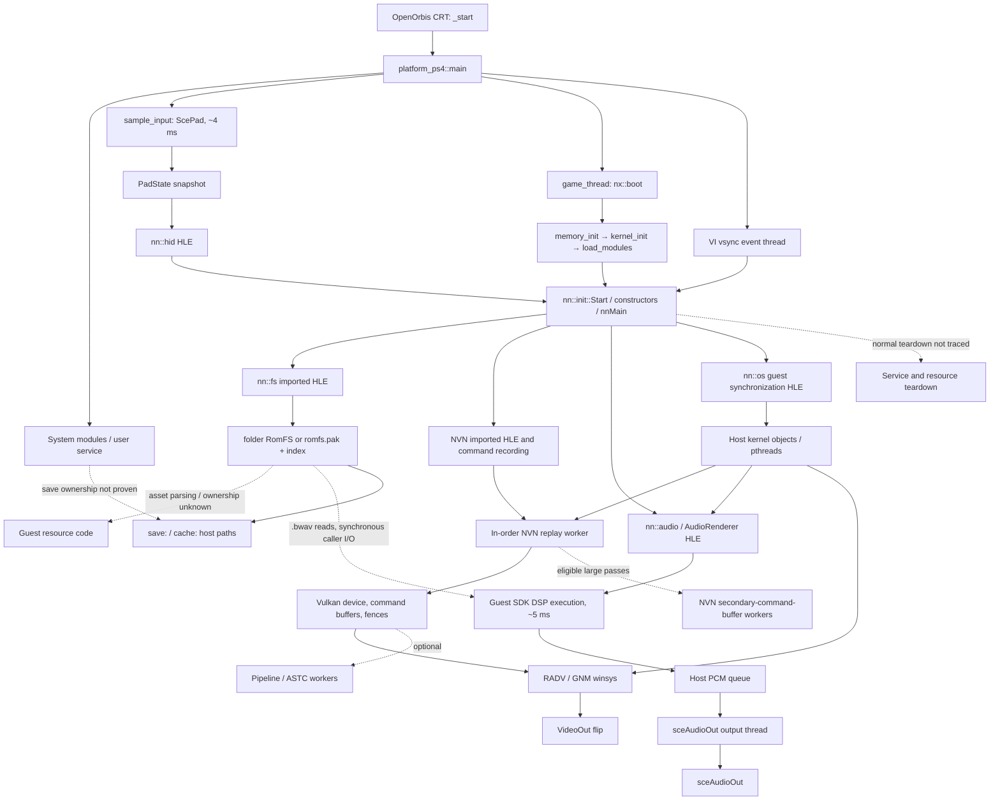

# Runtime dependency graph and threading

## Evidence boundary

The graph combines the PS4 implementation in `patches/botw-ps4.patch`, the
checked-in `port/` shims, and runtime logs already analyzed in the porting
audits. The full shared runtime source and generated BOTW code are absent.
Solid edges describe evidenced control/data dependencies; dotted edges
identify unverified or optional relationships. This is not a BOTW gameplay
call graph.

## Dependency graph

`platform_ps4::main` initializes user/pad support, starts the guest thread,
then samples input. The guest thread invokes `nx::boot`, which initializes
guest memory and kernel support, loads modules, and reaches SDK constructors
and `nnMain`. Rendering and audio are separate runtime paths. Guest update
ordering among input, gameplay, physics, and animation is **UNVERIFIED**.

## Worker and service threads

| Thread / worker | Creation and caller | Work / callee | Synchronization and lifetime |
|---|---|---|---|
| PS4 main/input thread | Process entry `platform_ps4::main` | `sample_input()`; samples controller state, scans user/controller changes every 500 ticks, then sleeps about 4 ms | Publishes `PadState` under `g_pad_lock`; runs until process exit. |
| Guest game thread | `main()` → `start_thread(game_thread, ..., 64 MiB)` | `game_thread()` → `nx::boot()` → guest SDK/game entry | Uses a reserved 64 MiB stack slot with one guard chunk; lazy-mapped stack pages. `nx::boot` return calls `exit_process`, not a documented orderly shutdown. |
| Guest worker threads | Guest kernel HLE → `plat::start_thread` | Guest recompiled routines | PS4 maps guest core masks to host affinity; thread completion marks its stack slot reusable. Guest `nn::os` synchronization maps to runtime kernel objects. |
| NVN replay thread | `worker_run()` starts detached `nvn_worker.cpp::run` on first queued job | Executes queued GPU jobs in serial order; `gpu_submit()` records/replays command lists | `g_enqueued`/`g_done` serials and condition variables; `worker_wait()` retries in 25 ms slices. The thread is persistent; no normal stop/join is evidenced. |
| NVN pass-recording workers | `gpu_submit()` → `parallel_begin_submit()` where allowed | Record eligible large passes using secondary Vulkan command buffers | Per-submit slot owns worker command pools, descriptor pools, and command buffers; workers are joined/finished before slot resources are reset. Infrastructure supports six worker indices; BOTW audit documents up to three active workers in the tested design. |
| Vulkan/RADV submission worker | Mesa PS4 winsys queue setup → `ps4_submit_thread` | Serializes GNM command submissions and flips | `ps4_job_lock`, queue condition variables, and VideoOut flip events order jobs. It is platform/driver infrastructure, not an NVN guest thread. |
| Guest AudioRenderer thread | Audio HLE starts `audio_render_thread` after renderer setup | Calls SDK `AudioRendererImpl::ExecuteAudioRendererRendering` in manual CPU mode | 5 ms pacing; `g_render_system` protects SDK renderer execution and guest event state. Exact guest event-to-host wait teardown is unavailable. |
| PS4 audio output thread | `audio_open()` → detached pthread `audio_thread` | Drains queued S16 stereo PCM into 256-frame 48 kHz `sceAudioOutOutput` grains | `g_audio` protects the queue; completion callbacks release submitted contexts. Emits silence on underrun/pause. The thread loops indefinitely; orderly close is not evidenced. |
| VI vsync thread | VI HLE initialization | Signals the guest system event at approximately 60 Hz | Event state and notification synchronization; at most one optional catch-up tick. Lifetime/stop behavior is not established. |
| Filesystem/I/O | Guest `nn::fs` HLE calls | `read_at`/`pread` synchronously reads the pack or file; `.bwav` may use in-memory read-ahead | Per-file read-ahead mutex and global budget; no dedicated general I/O worker is evidenced. |
| Optional pipeline/ASTC workers | NVN pipeline/upload implementation when async options are enabled | Builds Vulkan pipelines or decodes ASTC textures off the replay path | Internal condition variables and completion state; worker counts and shutdown behavior are configuration-dependent and not fully documented for BOTW. |

## Synchronization points

| Boundary | Synchronization | Porting significance |
|---|---|---|
| Guest wait/signal | Kernel HLE protects guest wait state with the runtime kernel lock and condition variables. Waits are sliced (default 25 ms) so a missed host notify can be rechecked. | A desktop port must preserve cancel-before-wait, timeout, wake, event-consume, TLS, and priority semantics; host CV semantics alone are not the ABI. |
| Input snapshot | `g_pad_lock` guards controller state; `nn::hid` polls connection changes and signals bound style events. | Controller polling should remain decoupled from guest thread execution. |
| Audio renderer | Renderer state lock and event/pacing state separate guest DSP stepping from output. | Preserve 5 ms render cadence and guest event signaling independently of SDL3 output buffering. |
| PCM queue | `g_audio` protects deque mutation and sample copy; completion callback marks buffers reusable. | The API retains caller data until the output thread consumes it; replacement sink must honor that lifetime or copy data. |
| RomFS pack | File handle offsets are explicit; read-ahead data is guarded per file and totals at most 16 MiB. | Use positioned reads or per-file serialization for shared pack access. No general asynchronous I/O queue is established. |
| NVN queue/replay | Job serials and a condition variable preserve replay order; guest waits only at relevant NVN synchronization points in the pipelined path. | Do not serialize every desktop frame unless profiling/compatibility requires it; do preserve fence and guest-memory visibility. |
| NVN submit resources | Vulkan fences retire submit slots, upload-ring ranges, descriptor pools, secondary command pools, and staged writebacks. | A slot must not be reset while GPU work or replay workers still reference it. |
| VideoOut reuse | `AcquireNextImageKHR` waits for the selected image to be off-screen by checking `flipArg` and flip events. GPU-side flip is ordered behind command submission. | Native desktop WSI should use acquire/present synchronization rather than copying the PS4 semaphore workaround. |
| RADV/GNM queue | Dedicated queue lock/condition variables serialize submits and flips. | Replace with standard Vulkan queue synchronization; do not retain GNM-specific submission semantics. |

## I/O-thread finding

The port documents a bounded `.bwav` read-ahead path, but the inspected
filesystem path performs positioned host reads synchronously on the caller.
No dedicated general I/O thread, task queue, or resource-load scheduler is
established. Treat audio read-ahead as a file-handle optimization, not as proof
of an asynchronous asset pipeline. The guest resource-loader-to-object
relationship remains **UNVERIFIED**.

## References

- [Services audit](./services.md): guest service boundaries and platform threads.
- [Architecture audit](./architecture.md): startup and frame-loop evidence.
- [Filesystem implementation delta](../../patches/botw-ps4.patch#L803).
- [PS4 platform implementation delta](../../patches/botw-ps4.patch#L10416).
- [NVN replay worker delta](../../patches/botw-ps4.patch#L9427).
- [PS4 GNM winsys adapter](../../port/mesa/ac_ps4_drm.c).
