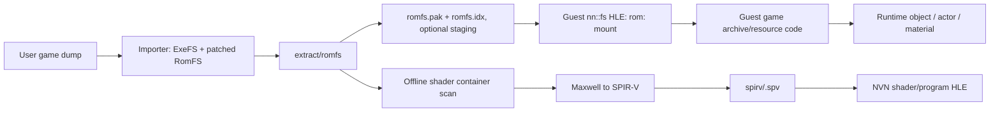
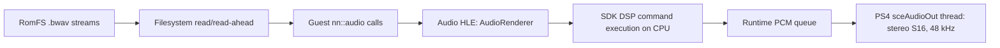
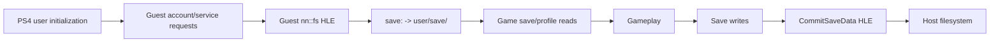

# BOTW platform services and filesystem audit

## Evidence boundary

This repository contains PS4 runtime shims, build scripts, runtime logs, and a
patch to the shared recompiler/runtime. It does not contain the full runtime
source or the game’s generated code. References to `runtime/src/...` below
denote paths in `patches/botw-ps4.patch`. Nintendo Switch service behavior
observed in logs is guest/HLE behavior, not a dependency on Nintendo libraries
linked into the PS4 executable.

## Filesystem and asset loading

| Finding | File / class | Function/symbol | Purpose | Dependencies | Porting impact |
|---|---|---|---|---|---|
| Guest filesystem HLE | `patches/botw-ps4.patch:803-1180`; `nx::fs` (runtime patch) | `OpenFile`, `ReadFile`, `OpenDirectory`, `Commit`, `CommitSaveData` (HLE registrations) | Implements imported `nn::fs` functions on host files; guest file service IPC is not required for these imports | Host stdio/filesystem, `plat::content_root` | Replace host paths and preserve guest file handles, errors and directory semantics |
| RomFS folder mount | `patches/botw-ps4.patch:803-890` | `load_pack`, filesystem path resolution | Reads extracted `extract/romfs` when available | POSIX/desktop filesystem | Map a portable installation data root and handle UTF-8 paths |
| RomFS packed form | [scripts/make-romfs-pack.py](../../scripts/make-romfs-pack.py), [scripts/stage-data.sh](../../scripts/stage-data.sh), patch `runtime/src/hle_fs.cpp` | `make-romfs-pack.py::main`, `load_pack`, `read_game_file` | Sort files, align each payload to 16 bytes, produce `romfs.pak` and tab-separated `romfs.idx`; runtime can open the pair instead of thousands of files | Python, local storage, index parser | Keep pack/index format or implement an equivalent archive VFS |
| Runtime evidence | [logs/v00.04/nx.log](../../logs/v00.04/nx.log):35-36,53-56 | `fs: RomFS pack`, `fs: mounted content`, content reads | 41,052 files and 875 folders in the observed staged pack; content reads include `Pack/Bootup.pack` and `Pack/TitleBG.pack` | `/data/BOTW`, pack/index, HLE filesystem | Use measured logs over stale comments; script docstrings also mention 304,207 files, which conflicts with the observed run |
| Resource archives | Patch `tools/maxwell/containers.py` changes at `13416-13502` | `open_blob`, `sarc_files`, `parse_vfxb` | SARC/Yaz0 extraction is used for offline shader discovery, including effect/layout/shader archives | `SARC`, Yaz0 | This parser is a shader tool, not proof of a runtime general archive/resource manager |
| Asset formats | Patch `tools/maxwell/containers.py`; `docs/GAPS.md` | SARC, Yaz0, FSHA, BNSH, VFXB, BAHS; AAMP/BYML/BFRES/BNTX | Shader tooling recognizes a subset of formats; general game asset loaders are not checked in | Game code/modules and RomFS | Keep all undocumented loader/lifetime claims **UNVERIFIED** until tracing guest file-to-object flow |
| PS4 network filesystem | [port/ps4_netfs.cpp](../../port/ps4_netfs.cpp):1-10,356-404,748-990 | `ps4_netfs_mount`, `ps4_netfs_open`, `__wrap_read`, `__wrap_pread`, `__wrap_stat`, `__wrap_getdents` | Optional read-only SMB/NFS `/net/<name>` filesystem beneath libc calls | `libsmb2`, `libnfs`, PS4 socket/network services | Not required for local game content; desktop should use native filesystem or an explicit network VFS |

`nn::fs` save and cache roots in the runtime patch are `private/user/save/<mount>`
and `private/user/cache<index>` (patch `runtime/src/hle_fs.cpp:803-814`).
`CommitSaveData` is registered by the SDK 7 BOTW symbol
(`patches/botw-ps4.patch:1162`). These are host-side abstractions for guest
filesystem imports, not a direct use of Nintendo RomFS/SaveData APIs on PS4.
The actual BOTW asset-to-runtime-object loader and ownership policy are
**UNVERIFIED**.

### Asset loading pipeline

Only the import/pack/HLE and shader translation/cache edges are verified by
repository files. The archive-to-game-object edge is **UNVERIFIED**.

## Audio architecture

| Finding | File / class | Function/symbol | Purpose | Dependencies | Porting impact |
|---|---|---|---|---|---|
| Guest audio service HLE | Patch `runtime/src/hle_audio.cpp:694-802` | `CreateAudioRendererManagerByHipc`, `OpenAudioRenderer`, `audio_render_thread`, `render_submit` | HLEs audren renderer and runs SDK DSP command processor on CPU; guest renderer is switched to manual CPU mode | SDK AudioRenderer implementation found by symbol, guest event signaling, 5 ms render cadence | Reimplement audio renderer service/DSP path or provide a compatible backend; do not confuse it with host output |
| SDK-sensitive discovery | `patches/botw-ps4.patch:694-802`; [docs/GAPS.md](../GAPS.md), audio notes | `find_symbol`, `ExecuteAudioRendererRendering`, SDK audio method HLE names | Runtime discovers renderer symbols and reads getter instructions to find fields; adapts SDK 7.3.2 offsets | Guest SDK symbol table and ARM instruction decoding | Replace fixed offsets with versioned symbol/layout discovery |
| Host mixer/output queue | `patches/botw-ps4.patch:11280-11344`; `nx::plat` | `audio_open`, `audio_submit`, `audio_thread` | Queues submitted stereo S16 PCM and outputs blocks on a separate thread | PS4 `sceAudioOut`, 48 kHz, pthreads | Replace `sceAudioOut` with SDL2 audio or another desktop sink; preserve queue ownership/backpressure |
| Runtime trace | [logs/v00.04/nx.log](../../logs/v00.04/nx.log):60-78 | `AudioRenderer` manager, renderer open, render thread, `sceAudioOut` | Confirms in-process manager, CPU render mode, render thread, host audio port | HLE and PS4 audio output | Use actual timing/error logs to validate replacement |
| Music/voice/streaming | Game audio event/data owners absent | BGM/SE/voice and stream scheduling: **UNVERIFIED** | No mixer groups, voice allocator, or music manager implementation is included | Guest audren commands; `.bwav` reads observed in HLE patch | Preserve guest DSP behavior and streamed-file latency; avoid inventing a Wwise/FMOD layer |

There is no checked-in FMOD or Wwise implementation. The visible stack is
Nintendo `nn::audio`/audren guest ABI → runtime CPU AudioRenderer execution →
PS4 `sceAudioOut`. Runtime filesystem notes in the patch describe streamed
`.bwav` files and read-ahead, but do not expose BOTW’s BGM/SE/voice ownership.

## Threading architecture

| Finding | File / class | Function/symbol | Purpose | Dependencies | Porting impact |
|---|---|---|---|---|---|
| Main/input thread | `patches/botw-ps4.patch:11507-11544`; `nx::plat` | `main`, `sample_input` | Initializes system/user/pad support, starts game thread and polls input every 4 ms | PS4 `ScePad`, pthreads | Replace with SDL2 event/controller loop; preserve input mapping and polling isolation |
| Guest/game thread | `patches/botw-ps4.patch:11458-11505` | `game_thread` | Runs `nx::boot` with a 64 MiB host stack | Guest runtime and host thread | Preserve nested guest call stack size and exception/reporting |
| Runtime pthread bridge | [port/ps4_runtime.cpp](../../port/ps4_runtime.cpp):657-772 | `__wrap_pthread_once`, `__wrap_pthread_create`, `startOnAppCores` | Fix PS4 pthread ABI/once behavior, stack floor, affinity and profiler registration | PS4 libkernel/pthreads, `sched_yield` | Remove PS4 wrappers on POSIX desktop; retain explicit stack, affinity and naming policy only if profiled |
| NVN replay queue | Patch `runtime/src/nvn/nvn_worker.cpp` and `nvn_vk.cpp` | replay worker and `gpu_submit` | Replays in-order NVN work asynchronously; waits where guest NVN synchronization requires | mutex/condition variables, Vulkan fences/queue | Map to a bounded executor and Vulkan submission thread; preserve guest-memory barriers |
| Parallel render workers | Patch `runtime/src/nvn/nvn_parallel.cpp`; BOTW config in patch `204-254` | `parallel_begin_submit`, worker dispatch | Records eligible large render passes in secondary Vulkan command buffers | up to three workers in tested design, per-worker pools/state | Test per-target ordering, resource ownership and frame determinism |
| RADV submit worker | [port/mesa/ac_ps4_drm.c](../../port/mesa/ac_ps4_drm.c):2529-2610 | `ps4_submit_thread`, `ps4_queue_job` | Serializes GNM submissions and flips on a dedicated thread | pthread condvars, GNM kernel API | Desktop uses driver queue submission; do not retain PS4 GNM submission queue |
| Audio render/output | Patch `runtime/src/hle_audio.cpp` and `runtime/src/platform_ps4.cpp:11280-11344` | `audio_render_thread`, `audio_thread` | Guest DSP stepping and host PCM output are separate from game/render threads | guest event waits, `sceAudioOut` | Keep audio deadline isolation and bounded buffering, but use desktop device callbacks |
| I/O/streaming topology | Runtime filesystem code only in patch | asynchronous I/O thread: **UNVERIFIED** | Read-ahead for `.bwav` is documented; no comprehensive dedicated I/O-thread topology is proven | Host file system and guest reads | Profile actual reads and blocking before introducing an I/O scheduler |
| Core placement | `logs/v00.04/boot-trace.log:7-13`; patch `runtime/src/platform_ps4.cpp` | `detect_cores`, `place_frame_thread`; `__wrap_pthread_create` | Assigns guest threads, replay/present, and host workers to PS4 cores | PS4 affinity masks and available seventh core | Desktop affinity is optional and should be measured, not copied from Jaguar topology |

No guest `nn::os::Thread` creation/update call graph is reconstructable from
this repository. PS4-side pthread wrappers and runtime worker comments are not
proof that all guest workers have a direct 1:1 host-thread mapping.

### Platform-specific implementation inventory

These are platform-specific implementations found in the repository itself or
in the checked-in recompiler patch. Patch entries name source files added or
changed by the port; the full patched source checkout is not present here.

| File | Class | Function/symbol | Target platform | Purpose | Dependencies | Porting impact |
|---|---|---|---|---|---|---|
| [port/ps4_crt1.S](../../port/ps4_crt1.S):12-75 | CRT entry | `_start`, `_start_ps4_c` | PS4/OpenOrbis | Calls C `main` and supplies system malloc-replacement table | OpenOrbis CRT, `ps4_replace_*` | Replace startup/linker contract; desktop CRT owns entry |
| [port/ps4_runtime.cpp](../../port/ps4_runtime.cpp):95-250, 580-640 | heap/OS shim | `createHeap`, `mapAndCreate`, `createDirectHeap`, `__wrap_mmap`, `__wrap_clock_gettime` | PS4/libkernel | Map flexible/direct memory, back allocator, route mappings and monotonic clock | `sceKernel*`, dlmalloc, TSC | Use desktop virtual memory/clock/allocation, retain guest address reservations where needed |
| [port/ps4_dlmalloc.c](../../port/ps4_dlmalloc.c):1-33 | allocator backend | `create_mspace_with_base`, `ps4_heap_ok` | PS4 runtime | dlmalloc mspace configuration and integrity check | dlmalloc, host memory supplied by PS4 shim | Desktop allocator can replace this unless guest pointer/layout assumptions require emulated arena |
| [port/ps4_runtime.cpp](../../port/ps4_runtime.cpp):657-795 | threading shim | `__wrap_pthread_once`, `__wrap_pthread_create`, `startOnAppCores`, `ps4_boost_thread` | PS4 pthread/libkernel | Fix pthread ABI, stack minima, CPU affinity, thread priority and sampler registration | `scePthread*`, pthreads, profiler | Remove ABI workarounds; make affinity/priority policy configurable per desktop |
| [port/ps4_crashlog.cpp](../../port/ps4_crashlog.cpp):1-110, 263-320 | diagnostics and file wrappers | `ps4_install_signal_stack`, `ps4_boot_trace`, `__wrap_open`, `__wrap_close` | PS4/FreeBSD kernel | Alternate signal stacks, crash reporting and network-file dispatch | signals, kernel stack layout, `ps4_netfs` | Replace kernel-specific signal/register layouts and `/data/BOTW` paths |
| [port/ps4_sampler.cpp](../../port/ps4_sampler.cpp):1-20, 750-775 | profiler | `ps4_sampler_start`, `profHandler`, `ps4_watch_thread` | PS4/FreeBSD kernel | SIGPROF thread sampling and guest/JIT profiling output | PS4 signal context, pthread handles, kernel module info | Optional; replace with desktop profiler/perf APIs |
| [port/ps4_random.c](../../port/ps4_random.c):1-55 | entropy shim | `getentropy`, `getrandom` | PS4/FreeBSD kernel | Reads `kern.arandom` sysctl or `/dev/urandom` | PS4 sysctl and device file | Use platform CSPRNG API or standard `getrandom` implementation |
| [port/ps4_string.c](../../port/ps4_string.c):1-170 | libc overrides | `memcmp`, `bcmp`, `memcpy`, `memmove`, `memset` | PS4 Jaguar/SSE2 | SIMD replacements for OpenOrbis libc routines used by Mesa/runtime | SSE2, linker symbol precedence | Retain only if benchmarks justify; avoid duplicate libc definitions on desktop |
| [port/ps4_net.cpp](../../port/ps4_net.cpp):1-120 | DNS shim | `__wrap_getaddrinfo`, `gethostbyname`, `resolve` | PS4/SceNet | Resolve hostnames through `libSceNet` because OpenOrbis libc resolver lacks DNS configuration | `SceNet`, `SceSysmodule` | Use the operating system resolver; do not bind portable code to PS4 system modules |
| [port/ps4_netfs.cpp](../../port/ps4_netfs.cpp):1-10, 356-404, 748-990 | network VFS | `ps4_netfs_mount`, `ps4_netfs_open`, `__wrap_read`, `__wrap_stat` | PS4 | Read-only SMB/NFS mounts under `/net` | libsmb2/libnfs, PS4 libc wrappers | Optional feature; use native APIs or keep isolated behind VFS |
| [port/mesa/ac_ps4_drm.c](../../port/mesa/ac_ps4_drm.c):970-1040, 2529-2610 | Mesa winsys/DRM adapter | `ps4_start_flight_recorder`, `ps4_install_fault_capture`, `ps4_submit_thread`, `ps4_queue_job` | PS4 GNM | Direct memory, GNM submission, flip ordering, GPU fault capture | `sceKernel*`, `sceGnm*`, RADV/ACO/NIR | Replace the whole winsys with desktop RADV/loader; this is not portable Vulkan code |
| [toolchain/ps4-love-style.cmake](../../toolchain/ps4-love-style.cmake):8-120 | link/toolchain integration | `PS4_RUNTIME_SOURCES`, `ps4_link_mesa`, `ps4_add_eboot` | PS4/OpenOrbis | Select PS4 runtime sources, wrap libc calls, link static RADV and package fake SELF | OpenOrbis, LLVM/lld, Mesa archive, PS4 system libraries | Use native CMake targets and Vulkan loader; remove linker wraps and eboot packaging |
| [toolchain/libc-overlay/](../../toolchain/libc-overlay/) and [toolchain/prepare-sysroot.sh](../../toolchain/prepare-sysroot.sh) | ABI/header overlay | FreeBSD pthread, signal, socket, fcntl and mmap declarations | PS4/OpenOrbis | Reconcile musl headers with PS4 FreeBSD kernel ABI | OpenOrbis sysroot, PS4 kernel ABI | Do not carry compatibility typedefs into desktop headers |
| Patch `runtime/src/platform_ps4.cpp` at `10416-11546` | `nx::plat` | `main`, `audio_open`, `sample_input`, `vulkan_create_surface` | PS4 | Platform bootstrap, user/input/audio services, Vulkan surface creation | `SceUserService`, `ScePad`, `sceAudioOut`, VideoOut | Replace with SDL2, desktop audio backend, and native Vulkan surface |
| Patch `runtime/src/ps4/ps4_vk_wsi.cpp` at `12598-13296` | `nx::plat::ps4` | `CreateInstance`, `CreateDevice`, `CreateSwapchainKHR`, `QueuePresentKHR` | PS4/VideoOut | Vulkan WSI adapter and display flips | RADV ICD dispatch, VideoOut, GNM queue | Replace with standard desktop Vulkan WSI; not a Switch NVN implementation |

`_WIN32` occurs in the game configuration shim and the repository documents a
Windows debug build in [docs/WINDOWS.md](../WINDOWS.md). Vulkan validation
configuration is also provided by `scripts/run-win.ps1`. Android conditionals
and Linux host paths occur in the shared runtime delta, but the code enabling
those targets is not available as a standalone source checkout here. No SDL2,
D3D/DX12, Metal, or native Vulkan BOTW engine renderer was found in the checked
port files; Vulkan is the host implementation of the NVN compatibility layer.

## Save data and user services

| Finding | File / class | Function/symbol | Purpose | Dependencies | Porting impact |
|---|---|---|---|---|---|
| Save/cache host mapping | Patch `runtime/src/hle_fs.cpp:803-814` | `save:` mount and `cache:` mount | Guest save filesystem is rooted under `private/user/save/<mount>`; cache under `private/user/cache<index>` | Runtime data root and host file APIs | Use a per-user desktop application-data root and preserve mount names |
| Save commit | Patch `runtime/src/hle_fs.cpp:683-706` | `nn::fs::CommitSaveData` SDK 7 registration | Routes BOTW’s SDK-specific commit symbol to the host filesystem commit implementation | Guest SDK 7 import/linker | Verify flush/atomicity and error handling on target filesystem |
| Account service evidence | [logs/v00.04/nx.log](../../logs/v00.04/nx.log):18-25,53-58 | `acc:u0`, `GetService(set)`, language query | Guest asks for user/account and settings services during startup | HLE service manager and PS4 user service initialization | Replace account selection with explicit desktop profile selection |
| PS4 user binding | Patch `runtime/src/platform_ps4.cpp:11507-11544` | `sceUserServiceInitialize`, `scePadInit`, `scan_players` | Initializes PS4 user service and enumerates controller users | `SceUserService`, `ScePad` | Map desktop users/controllers; this alone does not prove a Nintendo save is account-bound |
| Save lifecycle/slots | `docs/WINDOWS.md:12-25,42-44`; user save outside code | Save-slot enumeration, profile serialization: **UNVERIFIED** | Logs/docs confirm saves and thumbnails exist on the tested build, but not slot schema or serialization APIs | Guest game code and filesystem HLE | Preserve exact guest save bytes and commit semantics; do not assume `MountSaveData` is called |
| Nintendo `nn::fs` service | Search of checked source and patch | `MountSaveData`: not found; direct SDK mount lifecycle: **UNVERIFIED** | Runtime exposes filesystem calls on host paths, not a demonstrated Switch save-data mount operation | HLE import bindings | Implement semantics at guest ABI boundary, not a fake Switch mount syscall |

### Save flow evidence and gaps

Only the user-service initialization, `acc:u0` request, save mount mapping,
and commit-symbol registration are evidenced. Whether the mount is bound to
that user, how many slots exist, and exact load/serialization/unmount ordering
are **UNVERIFIED**.

## Nintendo service dependency inventory

“SDK import” here means the recompiled guest expects a Nintendo symbol or
service. It does not mean this PS4 port links Nintendo’s SDK.

| Namespace/service | File / class | Function/symbol | Purpose/evidence | Dependencies | Porting impact |
|---|---|---|---|---|---|
| `nn::fs` | Patch `runtime/src/hle_fs.cpp:803-1180` | Open/read/directory/commit HLE; SDK 7 `CommitSaveData` | Host-file VFS, RomFS pack and user save/cache mappings | Host filesystem | Replace path roots, archive I/O, error mapping and commit guarantees |
| `nn::hid` | Patch `runtime/src/hle_hid.cpp:1182` onward; PS4 patch `platform_ps4.cpp` | Npad state HLE; `sample_input`, `read_extra_pad` | PS4 ScePad state adapted to guest Npad; `logs/v00.04/nx.log` reports style/state calls | ScePad, user service | Implement SDL2/gamepad mapping, players, hotplug and controller conventions |
| `nn::os` | Patch `runtime/src/kernel.cpp:1718` onward; `nx::boot` at patch `1980` | guest thread/synchronization HLE; `nn::init::Start` | Guest synchronization maps to runtime kernel primitives; wait-slice fix described in `docs/GAPS.md` | pthreads, atomics, condition variables | Preserve wakeup ordering, timeout, priority, TLS and guest-handle semantics |
| `nn::audio` | Patch `runtime/src/hle_audio.cpp:694-802` | AudioRenderer and AudioOut HLE | CPU rendering and host PCM output | Guest SDK symbols, PS4 `sceAudioOut` | Replace output backend and retain sample timing/queue behavior |
| `nn::account` | `logs/v00.04/nx.log:53-58`; PS4 patch `platform_ps4.cpp` | `acc:u0`; `sceUserServiceInitialize` | Account service requested during game bootstrap; PS4 initializes its user service | HLE service manager, PS4 user service | Provide deterministic user/profile selection and save isolation |
| `nn::socket` | [port/ps4_net.cpp](../../port/ps4_net.cpp):1-120; [port/ps4_netfs.cpp](../../port/ps4_netfs.cpp):1-10 | `__wrap_getaddrinfo`, `gethostbyname`, `sceNetResolver*` | PS4 DNS shim and optional SMB/NFS network filesystem, not evidence that BOTW calls Nintendo sockets | PS4 `SceNet`, socket libc, optional libsmb2/libnfs | Use native desktop sockets/DNS; guest `nn::socket` imports remain **UNVERIFIED** |
| `nn::oe` | `logs/v00.04/nx.log:13-17`; `docs/GAPS.md` | `appletOE`, launch parameters and notifications | HLE applet/launch service interactions logged; additional BOTW service names recorded in GAPS | HLE service manager and app lifecycle | Adapt launch parameters, focus/suspend, notifications to desktop application lifecycle |
| `nn::vi` | `logs/v00.04/nx.log:37`; patch `runtime/src/hle_vi.cpp:1637` onward | `vi: layer created -> native window`; `CreateNativeWindow` HLE | Guest creates display layer/window consumed by NVN | HLE VI, platform surface | Replace Switch layer/window with SDL2/Vulkan surface or a headless surface |
| `nn::init` | `logs/v00.04/nx.log:6`; patch `runtime/src/main.cpp:1980-2005` | `nn::init::Start`, `nnMain` | SDK entry sequence and module constructors | module loader, HLE SDK/kernel | Maintain startup/constructor ABI and exact initialization ordering |

No direct `nn::socket` usage was established. `nn::oe` and service-level
requests are inferred only from the concrete logs and HLE symbols named in the
patch; unobserved methods remain **UNVERIFIED**.

## Service porting risks

| Rank | Risk | Evidence | Porting impact |
|---|---|---|---|
| Critical | Save/profile binding and atomic commit semantics are incomplete | Save path and `CommitSaveData` registration exist, but no verified slot/user mount lifecycle | Preserve original save contents; test crash-safe writes, user isolation, migration and rollback |
| Critical | Guest OS synchronization is not equivalent to host defaults | `docs/GAPS.md` lost-wakeup incident; patch `runtime/src/kernel.cpp` and pthread wrappers | Validate wait/cancel/wake, mutex ownership, condition variables, TLS, priorities and timed waits under load |
| High | Audio uses a game SDK DSP routine plus PS4-specific output | `hle_audio.cpp` patch, `sceAudioOut` thread, SDK 7.3.2 offset note | Replace only the host sink initially; retain guest DSP semantics and 48 kHz queue behavior |
| High | RomFS may be large and serves concurrent world/audio reads | `nx.log` pack size/files, `hle_fs.cpp` read-ahead notes, `docs/GAPS.md` memory risk | Provide indexed/random-access reads, bounded read-ahead, decompression and memory pressure controls |
| High | Input/account service assumptions are console-specific | PS4 `ScePad`/user initialization and `nn::hid` adaptation | Use SDL2 controller and profile services without inheriting Switch button/user semantics accidentally |
| Medium | Network behavior is only partially scoped | PS4 DNS and SMB/NFS code; no verified Nintendo socket call path | Keep networking optional and independently replaceable |
| Medium | Shutdown order and service cleanup are unknown | No normal teardown trace in source/logs | Define explicit close/flush/join order only after observing guest exit behavior |
| Low | Data/config paths are PS4-specific | `/data/BOTW`, `scripts/stage-data.sh` | Move to a desktop user-data directory and make install/content roots configurable |
